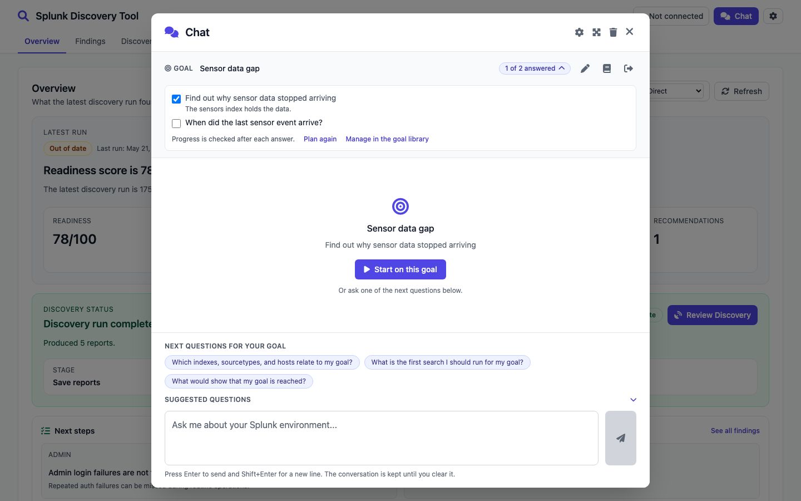
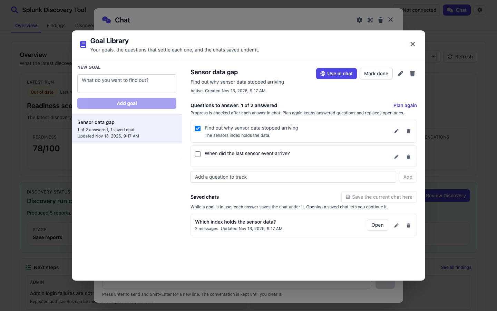
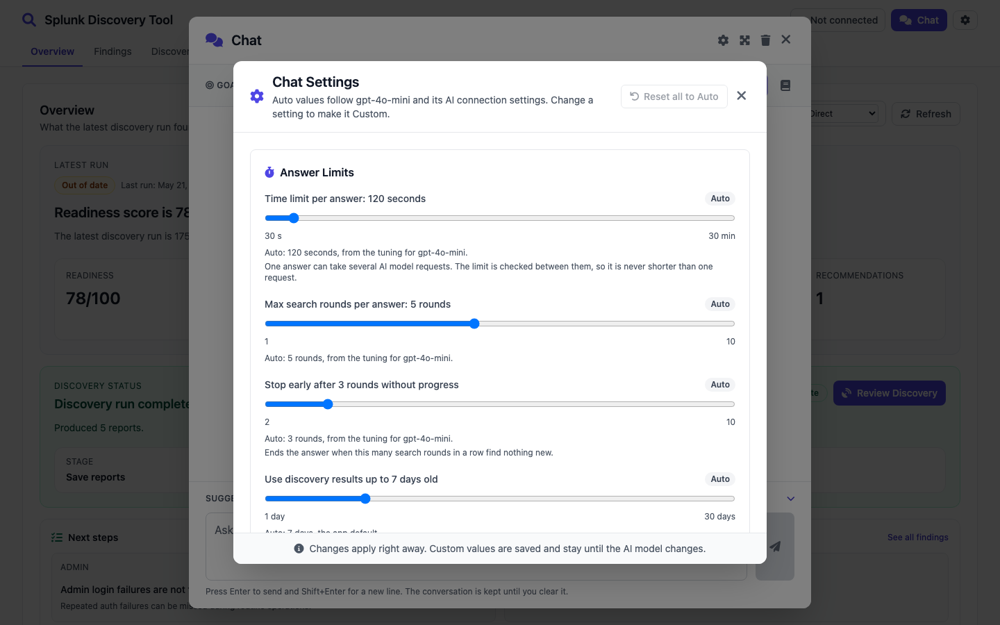
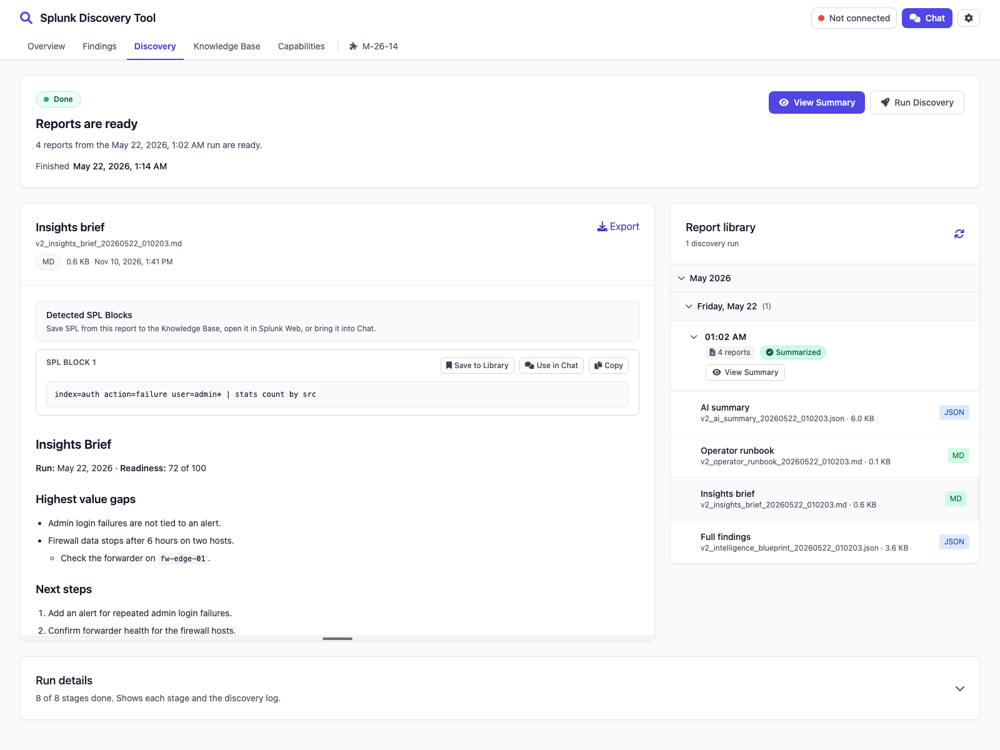

# 🔍 Splunk Discovery Tool

[](https://opensource.org/licenses/MIT)
[](https://www.python.org/downloads/)
[](https://github.com/LeiterConsulting/splunk-discovery-tool/releases/tag/v2.0.0)

> Finds what a Splunk environment contains, explains what to do next, and answers questions with live Splunk searches through the Splunk MCP server.

**Current release: [2.0.0](https://github.com/LeiterConsulting/splunk-discovery-tool/releases/tag/v2.0.0)** (November 13, 2026). See [CHANGELOG.md](CHANGELOG.md) for what changed and how to upgrade from 1.0.0.

## ✨ What's Included

- **Discovery**: a worker-backed pipeline that surveys the environment through MCP, keeps its progress across restarts, and saves an intelligence blueprint, an insights brief, an operator runbook, and a developer handoff (`v2_*` files in `output/`)
- **Workspace**: Overview, Findings, Discovery, Knowledge Base, and Capabilities tabs, plus tabs that enabled capabilities add (such as M-26-14)
- **AI summaries**: an on-demand summary of each discovery run with an executive summary, SPL queries, and admin tasks
- **Chat grounded in Splunk**: the chat agent runs one search at a time against the live MCP tool catalog, shows the SPL and time range that ran, and offers follow-on searches
- **Chat goals**: set a goal, and the AI model breaks it into questions, tracks which ones your answers settle, and suggests what to ask next. The Goal Library keeps goals, tracked questions, and saved chats
- **Settings tuned to the model**: model profiles, ranking, and auto-tuning for hosted and local models. Chat Settings start from the model's tuning and show each value as Auto or Custom
- **Knowledge library**: the environment profile from discovery, Splunk Security Content, Splunkbase records, and help.splunk.com documentation for your Splunk version and installed apps, downloaded for offline search, with a coverage scorecard and library packs for servers without internet access
- **Knowledge Base** (optional capability): managed knowledge assets, the SPL Library, and context previews, with a Reindex needed notice when its sources change
- **Troubleshooting**: Settings > Troubleshoot explains why an MCP server or AI model connection or save fails, without saving anything
- **Security**: optional local sign-in and OIDC, per-user MCP assignment, scoped tokens for a read-only external RAG API and an inbound MCP surface (HTTP plus a stdio bridge), and Fernet-encrypted settings with no plaintext secrets
- **Themes and accessibility**: Light, Dark, Neo, and System themes that meet WCAG AA contrast, checked by a browser test in CI
- **Installers** for Windows (`install.ps1`) and macOS or Linux (`install.sh`)

## 📋 Prerequisites

### Required

- Python 3.11+
- pip
- PowerShell 7+ (Windows only, if using `install.ps1`)

### External Services

- Splunk MCP server endpoint + bearer token
- An AI model: an API key for OpenAI, Azure OpenAI, Anthropic, or Gemini, or a local or custom OpenAI-compatible endpoint (such as Ollama, vLLM, or LM Studio)

## 🚀 Quick Start

### Windows

```powershell
.\install.ps1
```

### Unix/macOS

```bash
chmod +x install.sh
./install.sh
```

After startup, open the URL printed in the console (typically **http://localhost:8003**).

### Upgrading

Pull the new code in the install folder, then restart with the installer so the server runs the new code and updates its Python packages:

```bash
git pull
./install.sh --restart
```

```powershell
git pull
.\install.ps1 -Restart
```

Settings, keys, and `output/` stay in the install folder. Read the upgrade notes in [CHANGELOG.md](CHANGELOG.md) when moving between major versions.

## ⚙️ First-Time Configuration

1. Open the app at the startup URL shown in the console (default `http://localhost:8003`) and select **Set Up Connections** on the welcome screen, or open Settings (gear icon)
2. On **Settings > Connections**:
   - **Add MCP Server**: the MCP URL (for example `https://<splunk-host>:8089/services/mcp`), token, SSL verification, and an optional CA bundle file. Select **Test Connection**, then save
   - **Add AI Model**: provider, API key, endpoint URL (when required), and model. Select **Fetch Models** for a ranked list with a recommendation, then **Test Connection & Auto-Configure**, then save
3. Saved connections apply right away. You can keep several saved MCP configurations and AI model connections and switch between them
4. Optional: turn on sign-in, OIDC, and external access on **Settings > Users** and **Settings > Security**, and pick a theme on **Settings > Appearance**
5. Run discovery from the **Discovery** tab

If a test or save fails, open **Settings > Troubleshoot** (see [Troubleshooting](#-troubleshooting)).

### AI Model Notes

- Providers: `openai`, `azure`, `anthropic`, `gemini`, `ollama`, `custom` (any OpenAI-compatible endpoint, such as vLLM or LM Studio)
- Endpoint URL required for: `azure`, `custom`
- Endpoint URL optional override for: `anthropic`, `gemini`, `ollama` (defaults to the local Ollama port)
- For `custom`, you can use a base URL (for example `http://host:port/v1`); the app tries the common completion paths
- **Auto-tune** (on by default) sets the output length, temperature, context window, request timeout, and reasoning effort from the model's profile. You can override each value
- **Test Connection & Auto-Configure** runs a connectivity probe and a generation test with the tuned settings, and recommends settings for the model

## 🧠 Workspace Overview

The header holds the connection status, Chat, sign-in, and Settings. Each tab keeps its own actions, and the theme choice lives in Settings > Appearance.

- **Overview**: Discovery status, key numbers, the top three next steps, run comparison, the runbook, and report packages
- **Findings**: The full next-step lists for admins, analysts, and executives, the environment profile, key evidence, and patterns
- **Discovery**: Run discovery, follow each stage, and open saved reports and summaries
- **Knowledge Base**: Library health (how well public Splunk references, Splunkbase, and versioned docs cover your environment, with gaps to fix), searchable Splunk documentation for your versions and installed apps, managed knowledge assets, the SPL Library, reusable query evidence, and context previews
- **Capabilities**: Optional add-ons for the knowledge base, exports, charts, and Splunk search links. Each can be installed, turned on or off, tested, and removed
- **Capability tabs**: An enabled capability can add its own tab after the core tabs. The M-26-14 Readiness Advisor adds an M-26-14 tab
- **Chat and Summary**: Investigation chat (in a window or full screen) plus the runbook and summary views when you need more detail

## 💬 Chat, Goals, and Chat Settings

Chat answers questions about your Splunk environment with live searches through the MCP server, using what discovery found to pick indexes, sourcetypes, and hosts.

- **Goals**: type what you want to find out and select **Set goal**. The AI model breaks the goal into 3 to 6 questions that settle it and suggests the first questions to ask. **Start on this goal** sends a first message that runs the first search
- **Progress**: after each answer, the app checks which tracked questions the answer settled (only answers backed by search evidence count), may add up to 2 new open questions, and refreshes the suggestions. The goal bar shows progress such as "1 of 4 answered" and opens a checklist you can tick by hand, with **Plan again** and **Check progress now**
- **Goal Library**: add, rename, rewrite, finish, and delete goals; edit the tracked questions; and open, rename, and delete the chats saved under each goal. Each recorded answer saves the chat under its goal
- **Chat Settings** (gear icon in the chat header): each setting starts as Auto, from the AI model's tuning, and becomes Custom when you change it. Custom values stay across restarts and are cleared when the AI model changes. **Reset all to Auto** clears them
- **Search the Knowledge Base**: when it is on, chat adds matching Knowledge Base passages and downloaded Splunk documentation, with links, to its answers

Goals and saved chats are kept per user when sign-in is on and in one shared library when it is off, under `output/chat_data/`.







## 📚 Knowledge Library and Splunk Documentation

Library health on the Knowledge Base tab scores how well reference sources cover the environment from your latest discovery and lists gaps with a next action (missing or turned-off add-ons, outdated or archived apps, apps not marked Cloud compatible, and busy sourcetypes no public reference describes).

- **Sources**: Splunk Security Content data sources, Splunkbase records for your installed apps, and the help.splunk.com documentation index
- **Documentation**: **Download documentation** saves the help.splunk.com manuals for your platform version and installed apps (up to 8,000 pages) into a local search index. Downloads are slow on purpose and stop when the site refuses requests. Chat uses the pages only when Search the Knowledge Base is on
- **Online sources are off by default**. An admin turns on **Download sources from the internet** under Sources. Requests go only to `api.github.com`, `raw.githubusercontent.com`, `splunkbase.splunk.com`, and `help.splunk.com` over HTTPS
- **Servers without internet access**: **Export library pack** on a connected server and **Import library pack** on the offline one (up to 100 MB, checked before anything is saved)
- The documentation has its own index, so it never needs a Knowledge Base reindex. The Knowledge Base shows **Reindex needed** when it was never indexed, when reports or other source files changed after the last index, or when the index uses an older format. Report changes are never indexed on their own; documents you import into the Knowledge Base are indexed when you import them

## 📸 Current Workspace Snapshots

### First-run splash and workspace shell


### Overview tab


### Findings tab


### Discovery tab



## 📸 SPL Library Workflow

The SPL Library keeps reusable SPL in the managed context workspace so operators can save good queries from chat, inspect stored context, and reuse saved SPL without leaving the tool.

### Save a Query From Chat


### Browse the SPL Library


### Inspect Stored Asset Detail


### Reuse Library Context in Chat


## 🔐 Security

- Sign-in is off after install, and anyone who can reach the app can use it until an admin turns it on
- Optional local username/password sign-in with a password reset on first login
- OIDC sign-in with provider metadata, claim mapping, and local-user linking support
- Per-user MCP assignment plus admin-managed connection, user, and token controls
- Read-only external RAG REST API and inbound MCP access with scoped tokens and rate limiting
- Chat goals and saved chats are kept per user when sign-in is on
- Credentials encrypted at rest (`config.encrypted`, `.config.key`); no plaintext secrets are stored, and troubleshooting reports hide tokens and keys
- Configurable SSL verification and CA bundle support
- Host/CORS protections available via server settings
- Knowledge library downloads are off until an admin turns them on, and reach only four allowed HTTPS hosts

## 📁 Key Paths

```text
install.ps1 / install.sh        Installer + service control
src/main.py                     Runtime entrypoint
src/app_version.py              Release version
src/web_app.py                  FastAPI API + frontend delivery/runtime orchestration
src/frontend_legacy_template.html Source-of-truth frontend template
src/frontend_legacy.py          Frontend template loader for runtime and build tooling
src/static/                     Shipped local frontend bundle (built, checked in)
src/discovery/                  Discovery engine, v2 pipeline, and environment profile
src/chat_agent.py               Grounded chat prompts, tool outcomes, and evidence
src/chat_settings.py            Chat settings with Auto values from the model's tuning
src/chat_goals.py               Chat goals, tracked questions, and saved chats
src/llm/                        AI provider clients, model profiles, and auto-tuning
src/knowledge_library/          Library sources, documentation index, ranking, and scorecard
src/capabilities/               Optional capabilities (Knowledge Base, exports, charts, links, M-26-14)
src/troubleshooting.py          Settings > Troubleshoot checks
src/config_manager.py           Encrypted config manager
src/security_manager.py         Local auth, OIDC, sessions, roles, and token management
src/runtime_job_worker.py       Detached worker entrypoint for durable discovery/summary jobs
tools/build_frontend.mjs        Rebuild shipped frontend assets from src/frontend_legacy_template.html
tools/check_frontend_sync.py    Validate frontend bundle sync before release
tools/test_*_browser.mjs        Browser regression suites (Playwright)
tools/run_account_function_tests.mjs Account/auth regression entrypoint
.github/workflows/repo-validation.yml  GitHub Actions validation workflow for repo quality gates
output/                         Discovery reports, summaries, chat data, and the knowledge library
```

## 📚 Documentation

- [CHANGELOG.md](CHANGELOG.md): release history, highlights, and upgrade notes
- [CONFIGURATION_VARIABLES.md](CONFIGURATION_VARIABLES.md): settings, limits, defaults, and routes
- [docs/DEVELOPER_REFERENCE.md](docs/DEVELOPER_REFERENCE.md): code layout, extension points, and the endpoint map
- [docs/DISCOVERY_ARCHITECTURE_GUIDE.md](docs/DISCOVERY_ARCHITECTURE_GUIDE.md): discovery artifacts, the workspace model, and chat architecture
- [docs/OPTIONAL_CAPABILITIES_ARCHITECTURE.md](docs/OPTIONAL_CAPABILITIES_ARCHITECTURE.md): the optional capability model (Knowledge Base, exports, charts, links, capability tabs)
- [docs/SECURITY_ACCESS_ROADMAP.md](docs/SECURITY_ACCESS_ROADMAP.md): the shipped security model plus extension notes
- [docs/AUTH_TESTING.md](docs/AUTH_TESTING.md): local-password, OIDC, and account-function test guidance
- [docs/EXTERNAL_RAG_API_QUICKSTART.md](docs/EXTERNAL_RAG_API_QUICKSTART.md): read-only external RAG API setup and examples
- [docs/EXTERNAL_MCP_QUICKSTART.md](docs/EXTERNAL_MCP_QUICKSTART.md): inbound MCP setup, helper client, and stdio bridge usage
- [docs/M-26-14/](docs/M-26-14/): the M-26-14 Readiness Advisor plan and development ledger

## ✅ Validation

From an activated virtual environment with the dev requirements (`pip install -r requirements-dev.txt`) and the Node packages (`npm ci`, then `npx playwright install chromium` once), the release checks are:

```bash
npm run build:frontend
python tools/check_frontend_sync.py
npm run test:browser
npm run test:settings-profiles-browser
npm run test:settings-troubleshoot-browser
npm run test:ui-contrast-browser
npm run test:auth-browser
npm run test:account-functions
python -m ruff check src tests
python -W error::SyntaxWarning -m compileall -q src tests
python -m unittest discover -v
```

GitHub Actions runs the same checks on Ubuntu and Windows for every push and pull request (`.github/workflows/repo-validation.yml`).
## 🛠️ Installer Commands

| Command | Description |
|---------|-------------|
| `(no arguments)` | Install dependencies and start service |
| `--public_only` / `-PublicOnly` | Install using public PyPI only (skip private/local indexes) |
| `--start` / `-Start` | Start service |
| `--stop` / `-Stop` | Stop service |
| `--restart` / `-Restart` | Restart service |
| `--status` / `-Status` | Show status |
| `--uninstall` / `-Uninstall` | Uninstall |
| `--help` / `-Help` | Show help |

## 🐛 Troubleshooting

### Saving or connecting fails: use Settings > Troubleshoot

Open **Settings > Troubleshoot**, pick **MCP Server** or **AI Provider**, enter the values that fail, and click **Run Checks**. Nothing is saved. The checks run in stages and explain what to fix:

- **App and server**: whether the running server still uses the code in the install folder, missing Python packages, other copies of the app on ports 8003-8023, and whether your account may save settings
- **Values entered**: the same validation the save uses, URL mistakes (Splunk Web port 8000 instead of 8089, `http` on 8089, missing `/services/mcp`), pasted `Bearer ` prefixes or spaces, expired tokens, and CA bundle files
- **Saving**: where settings are stored, folder permissions and disk space, whether the settings file opens with its key, and a test save to a temporary copy
- **Network**: proxy, DNS, TCP, and TLS certificate trust (including Splunk's self-signed certificate)
- **Response**: what the MCP server or AI provider answered (401, 403, 404, web pages instead of MCP, tool count, model errors)

The **Troubleshoot** buttons next to **Test Connection** carry the values from the form, and a failed save or test offers to open the troubleshooter. **Copy Report** copies a plain-text report with tokens and keys hidden, which you can send with a support request.

### Saves still fail after `git pull`

The browser loads the new pages as soon as the files change, but the server keeps running the old code until it restarts, so fixes don't take effect and new pages can fail against the old server. Settings shows a banner when this happens. Restart from the install folder:

```bash
./install.sh --restart
```

```powershell
.\install.ps1 -Restart
```

The installers reinstall Python packages when `requirements.txt` changes, warn when the running service is older than the files, always start the app from the install folder (settings, keys, and output are stored there), and print the port the app actually uses.

### Port 8003 is already in use, or the banner stays after a restart

The app moves to the next free port automatically, and the installer prints the address it uses. A copy of the app installed earlier in another folder keeps answering on its port with its own code, so a bookmark for `http://<host>:8003` reaches that copy, and restarting the new install doesn't change it. When the server is out of date, the Settings banner names its port and links to an up-to-date copy if one is running on a nearby port. The installers list the other copies with their process IDs and folders after starting, and with `--status` / `-Status`:

```text
⚠ Other programs are using the app's ports on this computer:
    port 8003: another copy of the app (PID 21079), started from /home/me/old-folder
  To run only this copy: kill 21079 && ./install.sh --restart
```

Run the printed command in the folder of the copy you want to keep, so that copy moves back to port 8003. On Windows the command uses `Stop-Process -Id <PID>; .\install.ps1 -Restart`.

### Windows script execution blocked

```powershell
Set-ExecutionPolicy -Scope CurrentUser -ExecutionPolicy RemoteSigned
```

### MCP connection errors

- Run **Settings > Troubleshoot** with the URL and token
- For private certificate chains, turn on **Verify SSL Certificate** and enter the path of a `.pem` file on the app server in **CA Bundle File**, or turn verification off for a self-signed lab server

### pip install timeout / `repo.splunkdev.net` unreachable

- Some systems have a global/private pip index configured; if that index is unavailable, dependency install can time out.
- The installers now retry automatically against public PyPI (`https://pypi.org/simple`).
- To bypass private/local indexes immediately, use the installer public-only flag:

```bash
./install.sh --public_only
```

```powershell
.\install.ps1 -PublicOnly
```

- If needed, force PyPI for the current shell session before reinstall:

```bash
export PIP_INDEX_URL=https://pypi.org/simple
./install.sh
```

```powershell
$env:PIP_INDEX_URL = "https://pypi.org/simple"
.\install.ps1
```

### Frontend changes are not showing up or startup warns about stale assets

- The shipped UI is served from checked-in files under `src/static/`.
- After editing the frontend source template in `src/frontend_legacy_template.html`, rebuild and verify the shipped bundle:

```bash
npm run build:frontend
python tools/check_frontend_sync.py
```

- To run the deterministic browser regression for visualization previews, install the Chromium test browser once and run:

```bash
npx playwright install chromium
npm run test:browser
```

- To check saving, loading, testing, and deleting MCP configurations in Settings (including names with quotes, slashes, and `#`), and the Troubleshoot tab, run:

```bash
npm run test:settings-profiles-browser
npm run test:settings-troubleshoot-browser
```

- To validate auth-enabled flows and the account-function matrix, run:

```bash
npm run test:auth-browser
npm run test:account-functions
```

## 🤝 Contributing

Contributions are welcome via pull requests. Repo validation is also mirrored in `.github/workflows/repo-validation.yml`, which runs the documented frontend build, sync, browser regression, auth/account checks, lint, compile, and unittest gates on GitHub-hosted runners.

## 📄 License

MIT. See [LICENSE](LICENSE).
