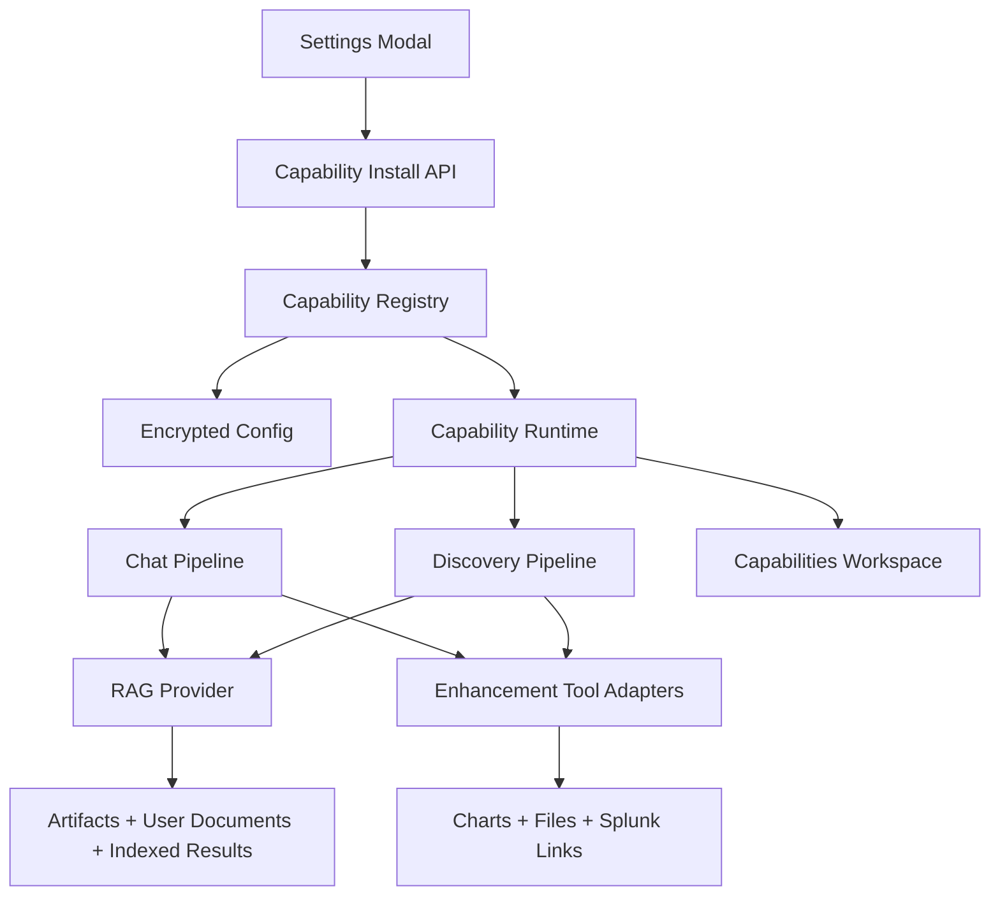

# Optional Capabilities Architecture

## Intent

This document explores an optional capabilities model for Splunk Discovery Tool that adds:

- an installable RAG subsystem, potentially backed by ChromaDB
- optional enhancement tool packs for visuals, exports, and Splunk deep links
- clear UI signals that these capabilities are actively improving outcomes

The goal is not to make RAG or enhancement tooling mandatory. The default product should remain lightweight and functional with the current deterministic routes, report-aware reasoning, and MCP integration. Optional capabilities should act as force multipliers.

## Status in Release 2.0.0

This document began as a proposal. Most of the framework has shipped. Sections below are marked **Shipped**, **Partly shipped**, or **Proposal**, and notes describe where the shipped code differs from the original design.

Shipped capability registry (`src/capabilities/registry.py`). Every capability is off until someone installs and turns it on:

| Capability | Name in code | Category | Install method |
| --- | --- | --- | --- |
| M-26-14 Readiness Advisor | `m26_14_advisor` | advisor | internal |
| Quick Report Search | `rag_local` | rag | internal |
| Knowledge Base | `rag_chromadb` | rag | pip (`chromadb>=1.0,<2`), restart required after install |
| Splunk Search Links | `splunk_deeplink_tools` | tool_pack | internal |
| Charts | `visualization_tools` | tool_pack | internal |
| Report Packages | `export_tools` | tool_pack | internal |

Capabilities can be installed, turned on, turned off, removed, tested, reindexed (Knowledge Base), and configured from the Capabilities workspace tab. Shipped features that the original proposal did not cover are described in [Shipped Additions](#shipped-additions).

## Current State

> Historical: this section describes the app when the proposal was written. In 2.0.0, chat settings persist in `output/chat_data/chat_settings.json`, Quick Report Search (`rag_local`) formalizes the snippet retrieval, the registry and install manager exist, and the UI source lives in `src/frontend_legacy_template.html` instead of inline in `src/web_app.py`. `build_lightweight_rag_context()` still exists in `src/web_app.py` but now calls the capability-aware `get_optional_rag_context()`.

The application at the time already had several pieces that made this feasible:

- chat augmentation is already optional via session-scoped chat settings
- a lightweight local RAG function exists today: `build_lightweight_rag_context()` in `src/web_app.py`
- encrypted persistent configuration already exists in `src/config_manager.py`
- the UI already supports multi-surface workflows using workspace tabs plus a Settings modal
- MCP configuration and LLM credential vault patterns already exist and can be reused for capability install/load/configure flows

Constraints in the current implementation:

- chat settings are session-based and reset on server restart
- the existing local RAG is only a text-snippet grab from recent output files, not a true retrieval system
- there is no installable feature registry or optional dependency management model yet
- the UI is currently a large inline React/Babel surface in `src/web_app.py`, so new capability pages should avoid uncontrolled sprawl

## Design Principles

**Shipped.** These principles hold in 2.0.0, with one change to principle 5: install, turn on, turn off, remove, test, and configure all happen on the Capabilities workspace tab. Settings has no capability section.

1. Optional first

Capability packs must be off by default and absent from the runtime path unless explicitly installed and enabled.

2. Visible value

If RAG or an enhancement pack contributes to an answer, the user should see that contribution directly.

3. Safe degradation

If a capability is not installed, fails health checks, or becomes stale, the app should fall back cleanly to the current deterministic and agentic paths.

4. Capability abstraction before dependency choice

Do not bind the product architecture directly to ChromaDB, ReportLab, python-pptx, or any external MCP add-on. Introduce interfaces first, then plug in concrete backends.

5. Install from settings, operate from dedicated workspace

Settings should be used to install, enable, disable, and test optional capabilities. Ongoing configuration, content management, indexing, and health visibility should live in a dedicated workspace tab or page.

## Recommended Product Model

Introduce a new concept: `capability packs`.

**Shipped.** All five suggested packs shipped under these names, plus `m26_14_advisor` (see the registry table above). The shipped titles are Quick Report Search, Knowledge Base, Charts, Report Packages, and Splunk Search Links.

Suggested initial packs:

- `rag_local`: existing lightweight output-file retrieval, formalized as a capability
- `rag_chromadb`: optional embedded vector store and richer retrieval/indexing pipeline
- `visualization_tools`: tools that transform Splunk results into charts, timeline views, and export-ready visual specs
- `export_tools`: tools that generate downloadable PDF, PPTX, and report bundles
- `splunk_deeplink_tools`: tools that generate direct Splunk Web deep links using active MCP/server context

The proposal suggested four states: `not_installed`, `installed`, `enabled`, and `degraded`. The shipped model keeps `installed` and `enabled` as separate flags in each capability's config and reports a `health_status` of:

- `not_installed`
- `disabled` (installed but turned off)
- `ready`
- `degraded`

A separate `restart_required` flag covers installs that need an app restart (the Knowledge Base).

`degraded` is important. It gives the UI a way to say "this is present but unhealthy or stale" instead of failing silently.

## Architecture Overview



In 2.0.0 the install controls sit on the Capabilities workspace tab rather than in the Settings modal; the rest of the flow matches the diagram.

## Proposed Backend Structure

**Shipped, with small differences.** The shipped layout has `rag/asset_manager.py` for imported Knowledge Base documents, names the export module `tools/exporter.py`, and has no `tools/base.py`. The tool providers are `SplunkDeepLinkProvider`, `VisualizationPreviewProvider`, and `DeterministicExportProvider`.

Add a new package family under `src/capabilities/`.

Suggested layout:

```text
src/capabilities/
  __init__.py
  registry.py
  models.py
  install_manager.py
  health.py
  rag/
    __init__.py
    base.py
    lightweight.py
    chromadb_provider.py
    indexer.py
  tools/
    __init__.py
    base.py
    visualization.py
    export.py
    deeplink.py
```

Core responsibilities:

- `registry.py`: known capability pack definitions, dependency manifests, default config, health state
- `models.py`: dataclasses or pydantic models for installed packs, runtime config, jobs, health status
- `install_manager.py`: allowlisted package installation, uninstall, upgrade, restart-required checks
- `health.py`: background health probes and status normalization
- `rag/base.py`: retrieval interface used by chat/discovery logic
- `tools/base.py`: adapter interface for optional tools exposed to the LLM or deterministic routes

## Persistence Model

**Shipped.** `AppConfig.capabilities` in `src/config_manager.py` stores one `CapabilityConfig` per capability in `config.encrypted`. The shipped `CapabilityConfig` (in `src/capabilities/models.py`) has every suggested field plus `health_message`, `runtime_state`, and `installed_at`. `active_capability_profiles` was not added.

Extend the encrypted config model in `src/config_manager.py` to include persistent optional capability configuration.

Recommended additions:

```text
AppConfig
  capabilities: Dict[str, CapabilityConfig]
  active_capability_profiles: Dict[str, str]
```

Suggested `CapabilityConfig` fields:

- `name`
- `installed`
- `enabled`
- `version`
- `install_method`
- `health_status`
- `config`
- `last_tested_at`
- `last_error`
- `restart_required`

This should be persistent, unlike current chat session settings. RAG and optional pack state should survive restart.

## RAG Recommendation

### Recommendation: abstract first, Chroma second

**Shipped.** Both RAG capabilities sit behind `BaseRAGProvider` (`src/capabilities/rag/base.py`). Chat asks the Knowledge Base first and falls back to Quick Report Search when the Knowledge Base is not installed, not turned on, waiting for a restart, or returns nothing.

ChromaDB is a reasonable option, but it should not be the architecture. It should be one backend behind a `RAGProvider` interface.

Why this matters:

- Chroma adds install weight and runtime complexity
- vector store health/index lifecycle needs its own operational surface
- you may want a simpler local-only or sqlite-backed mode for lower-friction first runs

### Recommended RAG progression

#### Phase 1: formalize current lightweight RAG

Keep the existing snippet-retrieval concept, but move it behind the new provider interface.

Benefits:

- zero additional dependency cost
- immediate compatibility with current `output/` artifacts
- establishes the UI and observability model before vector indexing exists

#### Phase 2: optional ChromaDB local provider

**Shipped** as the Knowledge Base (`rag_chromadb`). The index lives under `output/rag/chromadb` (config `storage_dir`), and imported documents live under `output/rag/assets` unless `asset_dir` is set. The indexer skips the knowledge library and chat data folders under `output/`.

Add a Chroma-backed provider with:

- local embedded persistence under `output/rag/`
- collections for discovery artifacts, runbooks, handoffs, and user-uploaded content
- optional indexing of structured discovery payloads and chat-derived knowledge items

Suggested indexed content groups:

- intelligence blueprint summaries
- AI summary and insights brief content
- operator runbooks and developer handoff notes
- selected raw finding ledger entries
- optionally user-supplied reference docs

### RAG content sources

RAG should not only index free-form text files. It should have typed source categories:

- `discovery_artifact`
- `runbook`
- `handoff`
- `uploaded_document`
- `generated_summary`
- `chat_memory_derived`
- `tool_result_snapshot`

This allows better filtering and better UX when showing evidence.

**Shipped.** The indexer uses these source types and adds `knowledge_asset` for documents imported into the Knowledge Base.

## Make RAG Value Obvious

If optional RAG is enabled and contributes to a result, the user should see it.

Recommended UX signals:

- a `RAG enhanced` badge on answers that used retrieved evidence
- an expandable `Retrieved context used` section under the answer
- source cards showing file name, artifact type, timestamp, and retrieval score
- a timeline event such as `Retrieved 3 capability-boosting context chunks from indexed artifacts`
- follow-on actions annotated with why they were suggested

Example:

- `Validate Windows security live` because indexed runbook and intelligence brief both flag Windows Security Monitoring as a top-priority gap

Without this visibility, RAG becomes invisible plumbing and the user will not trust its value.

**Partly shipped.** Chat answers that used a capability show a Capability Evidence section that lists each contribution with its source passages and scores. Passages from downloaded Splunk documentation appear there too, labeled Splunk documentation. The other signals above remain proposals.

## How RAG Should Influence Chat

**Partly shipped.** Retrieved context goes into the prompt (place 1) only when Search the Knowledge Base is on in chat settings (`enable_rag_context`, with `rag_max_chunks` from 1 to 6). Places 2 to 4 remain proposals.

RAG should affect more than the prompt body.

Use it in four places:

1. Prompt context

Inject retrieved evidence into the system/user planning context, similar to the current lightweight RAG block.

2. Follow-on action generation

Allow retrieved evidence to bias follow-on suggestions toward indexed risks, gaps, recommendations, and known environment patterns.

3. Tool planning

Use RAG evidence to influence which live validation queries get tried first.

4. Post-result interpretation

Use retrieved documents to contextualize tool results, for example matching a spike to a known recommendation or known coverage gap.

## How RAG Should Influence Discovery

**Proposal.** Discovery does not use RAG retrieval in 2.0.0.

The discovery flow should remain grounded in actual Splunk data, but optional RAG can improve synthesis.

Recommended uses:

- retrieve prior runbooks and handoffs when generating new summaries
- compare new findings to historical discovery language for drift detection
- enrich recommendations with organization-specific documentation if uploaded
- support better executive and developer handoff outputs by referencing prior institutional context

Do not let RAG replace primary evidence from discovery results. It should enrich synthesis, not fabricate facts.

## Optional Enhancement Packs

### 1. Visualization Tools

**Shipped** as Charts (`visualization_tools`): line and bar charts drawn inside chat for supported results, with a configurable point limit (`max_preview_points`). PNG or SVG export and stored chart artifacts are not shipped.

Goal: convert Splunk results into useful charts without requiring the user to leave the app.

Recommended scope:

- line charts for time series
- bar charts for breakdowns
- tables with conditional formatting
- exportable PNG or SVG chart output
- chart specs stored as JSON artifacts

Implementation approach:

- generate chart-ready JSON server-side
- render preview in the UI using a client-side library later if desired
- expose an internal tool such as `create_visual_from_results`

Recommendation:

Treat this as an app-native tool pack first, not as an external MCP dependency. The current app can surface it through the same tool reasoning model without waiting for external MCP changes.

### 2. Export Tools

**Shipped differently** as Report Packages (`export_tools`): a downloadable zip of a run's reports and runbook, with a file manifest (JSON) and a summary note (Markdown), written to `output/exports`. PDF and PPTX output are not shipped, and no extra libraries are needed.

Goal: produce downloadable executive and operational outputs.

Recommended initial formats:

- PDF
- PPTX
- structured HTML bundle

Implementation approach:

- convert existing markdown/runbook/report artifacts into exportable templates
- add optional libraries only when the pack is installed

Likely libraries:

- `reportlab` or `weasyprint` for PDF
- `python-pptx` for PowerPoint

Recommendation:

Start with deterministic export generation from known artifact structures. Avoid free-form LLM-to-PDF flows at first.

### 3. Splunk Deeplink Tools

**Shipped** as Splunk Search Links (`splunk_deeplink_tools`): Open in Splunk links for SPL searches with an app and time range, added to chat answers and saved searches. The Splunk Web address comes from the `web_base_url` setting or is derived from the connection.

Goal: allow the app to return links that open directly into the associated Splunk instance.

Recommended functions:

- deeplink to search with SPL and time range
- deeplink to dashboards or saved searches when known
- deeplink to index-focused searches from follow-on suggestions

Implementation approach:

- derive base Splunk Web URL from MCP config or a dedicated Splunk Web setting
- URL-encode SPL and time bounds
- attach deep links to answer cards, follow-ons, and generated exports

This should be a strong force multiplier because it shortens the distance from recommendation to operator action.

## MCP Enhancements: Important Clarification

There are two ways to interpret `MCP enhancements`:

1. Additional external MCP servers or tools
2. Local tool packs, built into Splunk Discovery Tool, that use the same reasoning/tooling model

Recommendation:

Start with option 2.

**Shipped as option 2.** All tool packs are built into the app. A `tool provider` abstraction for other MCP servers is still a proposal.

Reason:

- you control lifecycle and install UX
- you avoid requiring users to stand up extra MCP infrastructure
- you can still present them as optional capabilities and later federate to true MCP servers if needed

If you want true multi-MCP support later, add a second-stage `tool provider` abstraction:

- `native`
- `primary_splunk_mcp`
- `secondary_mcp`

## Installation Model

Settings-driven installation is feasible, but it needs guardrails.

### Recommended install flow

**Shipped.** Only the Knowledge Base installs Python packages. Its allowlisted requirement comes from the registry (`dependency_packages`) and installs with `pip` into the Python environment running the app. If pip cannot install `onnxruntime`, the app retries without it, because the indexer supplies its own embedding function. After install the Knowledge Base shows Restart required until the app restarts.

1. Settings modal shows capability cards
2. User clicks `Install`
3. Backend runs an allowlisted dependency install using the current venv
4. Install status is written to persistent config and a capability manifest
5. UI shows one of:
   - `Ready`
   - `Restart required`
   - `Degraded`

### Guardrails

- do not allow arbitrary package names from the UI
- maintain a server-side allowlist manifest for optional dependencies
- record package version and install timestamp
- provide uninstall and health test actions

The shipped uninstall is the Remove action (`POST /api/capabilities/{name}/uninstall`). It turns the capability off and marks it not installed, but keeps its Python packages, its settings, and its Knowledge Base data, so a later install picks up where it left off.

### Installer script relationship

Do not overload `install.ps1` and `install.sh` with every optional capability path. Keep them focused on base application lifecycle.

Instead:

- the app handles optional pack installs at runtime
- installer scripts continue to own base app install/start/stop/restart
- optional pack installation can request a restart, but should not require reinstall

## UI Recommendation

### Settings modal

**Not shipped this way.** Settings has no capability section; the capability cards and their Install, Turn on, Turn off, Remove, test, and configure controls live on the Capabilities workspace tab.

Add a new section: `Optional Capabilities`

Each card should show:

- capability name
- what it adds
- install size or dependency note
- current state
- buttons for install, enable, disable, test, uninstall, configure

### Dedicated workspace tab

Add a new workspace tab next to the core workspace tabs:

- `Capabilities`

This is a better fit than trying to manage an operational RAG system entirely from the Settings modal.

**Shipped.** The workspace tabs are Overview, Findings, Discovery, Knowledge Base, and Capabilities, plus tabs added by enabled capabilities (see [Shipped Additions](#shipped-additions)). The Knowledge Base has its own tab instead of a RAG subsection. The Jobs and Health subsections were not built as separate pages; health shows on each capability card.

Suggested subsections:

- `RAG`
- `Enhancements`
- `Jobs`
- `Health`

### RAG page contents

**Mostly shipped** on the Knowledge Base tab: source inventory and counts, reindex with last indexed time, a context preview (search test), and document import, check-in, check-out, and delete. There is no provider selector; Quick Report Search and the Knowledge Base are separate capabilities.

- provider selector: lightweight or ChromaDB
- source inventory and document counts
- indexing jobs and last refresh times
- search test console
- retrieval previews
- content upload/manage UI

### Enhancement page contents

- visualization pack status and sample output
- export pack status and available templates
- deeplink pack status and test link generation
- optional future MCP provider registrations

## API Surface Proposal

**Shipped, with different routes.** The shipped capability routes in `src/web_app.py` are:

- `GET /api/capabilities` and `GET /api/capabilities/health`
- `POST /api/capabilities/{name}/install`, `/enable`, `/disable`, `/uninstall`, `/test`, `/reindex`, and `/config`
- `GET /api/capabilities/rag/assets` and `GET /api/capabilities/rag/assets/{asset_id}`
- `POST /api/capabilities/rag/assets/import/text` and `POST /api/capabilities/rag/assets/import/file`
- `POST /api/capabilities/rag/assets/{asset_id}/delete`, `/check-in`, and `/check-out`
- `POST /api/capabilities/rag/context/build` (context preview)
- `POST /api/capabilities/deeplinks/build`
- `POST /api/capabilities/exports/build` and `GET /api/capabilities/exports/download/{filename}`

Shipped routes take the capability name (`{name}`) where the proposal used `{id}`. The proposed `GET /api/capabilities/{id}/status`, `GET /api/capabilities/rag/sources`, `POST /api/capabilities/rag/search`, `POST /api/capabilities/rag/reindex`, and `POST /api/capabilities/exports/generate` routes were not added. State comes from `GET /api/capabilities`, reindex is `POST /api/capabilities/{name}/reindex`, search previews use `POST /api/capabilities/rag/context/build`, and exports use `POST /api/capabilities/exports/build`. The original proposed list follows.

Suggested endpoints:

- `GET /api/capabilities`
- `POST /api/capabilities/{id}/install`
- `POST /api/capabilities/{id}/uninstall`
- `POST /api/capabilities/{id}/enable`
- `POST /api/capabilities/{id}/disable`
- `POST /api/capabilities/{id}/test`
- `GET /api/capabilities/{id}/status`
- `POST /api/capabilities/rag/reindex`
- `GET /api/capabilities/rag/sources`
- `POST /api/capabilities/rag/search`
- `POST /api/capabilities/exports/generate`
- `POST /api/capabilities/deeplinks/build`

These endpoints should mirror the operational style already used by credentials, MCP configs, and chat settings.

## Discovery Pipeline Integration Points

**Proposal.** None of these hooks shipped. In particular, discovery does not queue a reindex; the Knowledge Base shows a Reindex needed notice instead (see [Shipped Additions](#shipped-additions)).

The current docs already define clean discovery extension points in `docs/DEVELOPER_REFERENCE.md`.

Recommended capability-aware discovery hooks:

- after bundle creation, enqueue RAG indexing for eligible artifacts
- during summarization, optionally retrieve related historical context
- during runbook generation, optionally enrich with indexed prior runbooks and uploaded documents
- write a capability-usage note into the generated summary when optional packs contributed materially

## Chat Pipeline Integration Points

Recommended modifications in `chat_with_splunk_logic()`:

- ask registry whether RAG is installed and enabled
- request a capability-aware context bundle rather than directly calling only `build_lightweight_rag_context()`
- pass capability evidence into follow-on action generation
- include a `capability_usage` block in the response payload for the UI

**Shipped.** `chat_with_splunk_logic()` asks the capability manager for context through `get_optional_rag_context()`, which also adds passages from the downloaded Splunk documentation, and the response carries `capability_usage`. The shipped `capability_usage` is a list instead of the object below. Each entry has `name`, `title`, `category`, `used_in`, `contribution`, `chunks`, and `reusable_queries`.

Original suggested response payload addition:

```json
{
  "capability_usage": {
    "rag": {
      "enabled": true,
      "provider": "chromadb",
      "sources_used": 3
    },
    "enhancement_tools": ["splunk_deeplink_tools"]
  }
}
```

## Implementation Phases

Status in 2.0.0: Phase 1 shipped (capability cards live on the Capabilities tab, not in Settings). Phase 2 shipped the evidence display; retrieval-aware follow-on actions are partly built through reusable queries. Phase 3 shipped. Phase 4 shipped without PDF or PPTX export. Phase 5 is still a proposal.

### Phase 1: capability framework

- add capability config model and registry
- add install/test/enable/disable endpoints
- move current lightweight RAG behind a provider interface
- add Settings modal capability cards
- add Capabilities workspace tab shell

### Phase 2: visible RAG value

- add evidence display in chat answers
- add retrieval-aware follow-on action generation
- add indexing of current discovery artifacts into a normalized source catalog

### Phase 3: ChromaDB provider

- add optional Chroma install flow
- add local collection/index lifecycle management
- add uploadable user document support

### Phase 4: enhancement packs

- add visualization tools
- add export tools
- add Splunk deeplink tools

### Phase 5: capability-aware discovery synthesis

- use indexed prior artifacts and user docs during summary/runbook generation
- surface capability contribution in generated outputs

## Strong Recommendation

The right first move is not "install ChromaDB".

The right first move is:

1. formalize capabilities as optional packs
2. persist capability state in encrypted config
3. create a dedicated Capabilities workspace tab
4. turn current lightweight RAG into a provider behind the new interface
5. make capability contribution visible in chat and discovery outputs

Once that foundation exists, adding ChromaDB is straightforward and low-risk.

Without that foundation, Chroma would add complexity before the product has a clean way to install, configure, observe, or prove the value of optional capabilities.

## Suggested First Implementation Slice

If implementing this incrementally, the best first slice is:

- add capability registry and persistent config model
- add `Capabilities` workspace tab
- move current local RAG into the `rag_local` capability (shipped as Quick Report Search; this list originally said `rag_lightweight`)
- show `RAG enhanced` evidence in chat when used
- add a single optional enhancement pack: `splunk_deeplink_tools`

That slice is valuable because it proves:

- optional install/config UX
- persistent feature state
- visible force multiplier behavior
- a clean path to richer packs later

## Shipped Additions

These shipped features were not part of the original proposal.

### Capability workspace tabs

A capability can declare a workspace tab (`CapabilityWorkspace` in `src/capabilities/models.py`, with an `id`, `label`, and `description`). The UI adds that tab only while the capability is installed and turned on. The M-26-14 Readiness Advisor uses this to add an M-26-14 tab (id `m26-14`) with its readiness estimate, run comparison, and live checks. Running a live check (`POST /api/discovery/m26-14/validate`) requires the analyst or admin role when sign-in is on.

### Remove (uninstall)

Remove calls `POST /api/capabilities/{name}/uninstall`. The capability is turned off and marked not installed. Python packages stay in the environment, and settings and Knowledge Base data stay on disk, so installing again restores the previous state.

### Index freshness and the Reindex needed notice

The Knowledge Base health details include `index_freshness`. Its `state` is `current`, `not_indexed`, `nothing_to_index`, or `outdated` (with a `reason` of `changed_files` or `index_format`, plus counts of changed files by source type). When the index is missing or outdated, the Knowledge Base shows a Reindex needed notice. New or changed report files are never indexed on their own; reindexing runs only when someone selects Reindex. Importing, deleting, checking in, or checking out a Knowledge Base document is the one exception: it reindexes right away while `auto_reindex_on_asset_change` is on (the default).

### The knowledge library is separate from the Knowledge Base index

The knowledge library (`src/knowledge_library/`) downloads Splunk documentation that matches the environment and stores it in its own SQLite index, `output/knowledge_library/docs/library_docs.sqlite3`. The Knowledge Base indexer skips that folder, so the documentation never needs a reindex. Chat adds documentation passages only when Search the Knowledge Base is on. Online library sources are off by default (`library.allow_online_sources`), and only admins can turn them on, refresh them, or import a library pack (`POST /api/knowledge-library/settings`, `POST /api/knowledge-library/refresh`, `POST /api/knowledge-library/pack/import`). The external RAG API and inbound MCP tools read the Knowledge Base only, not the knowledge library.
